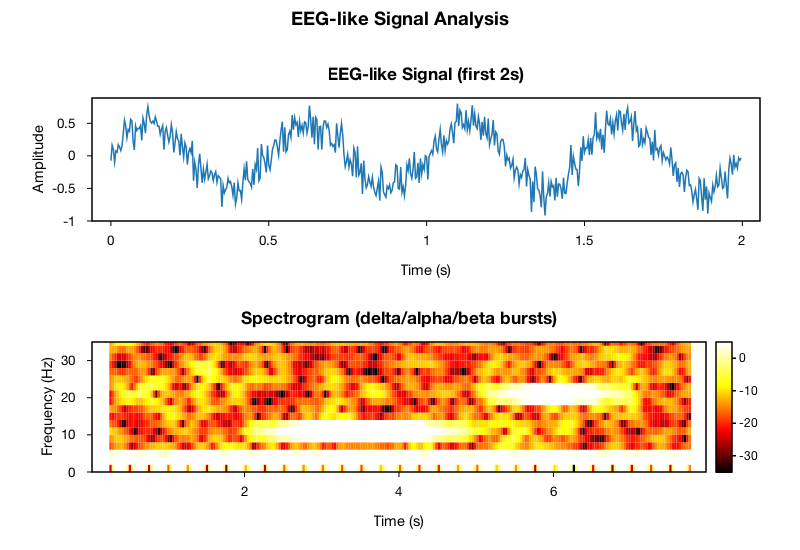
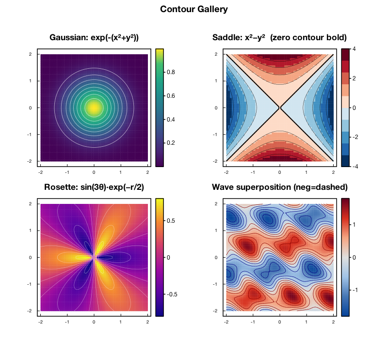
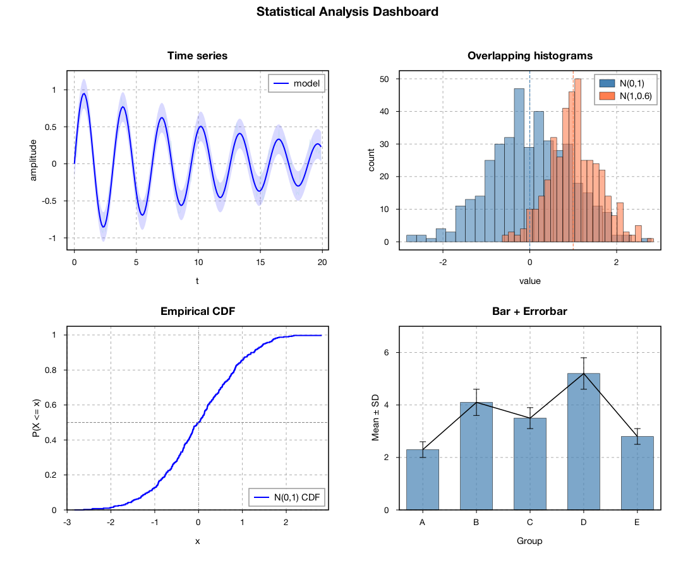
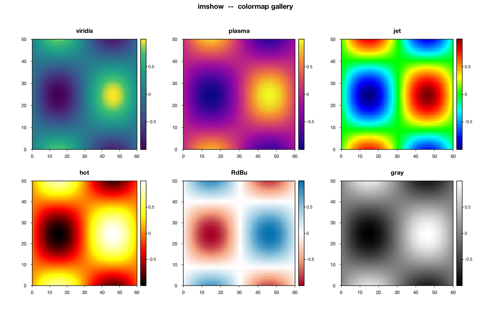
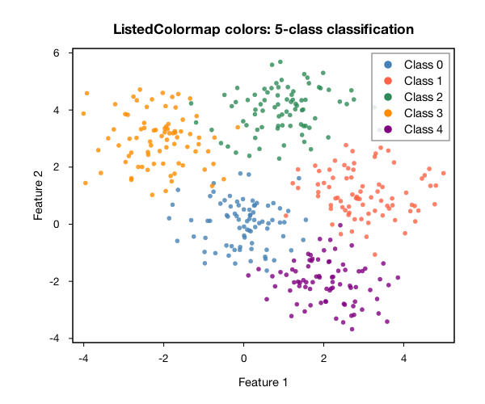
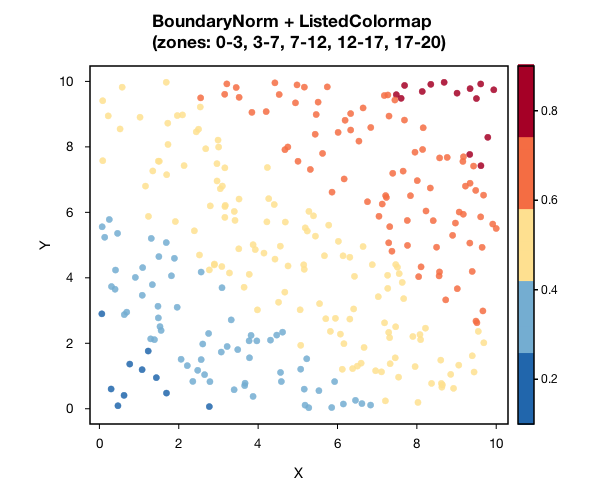
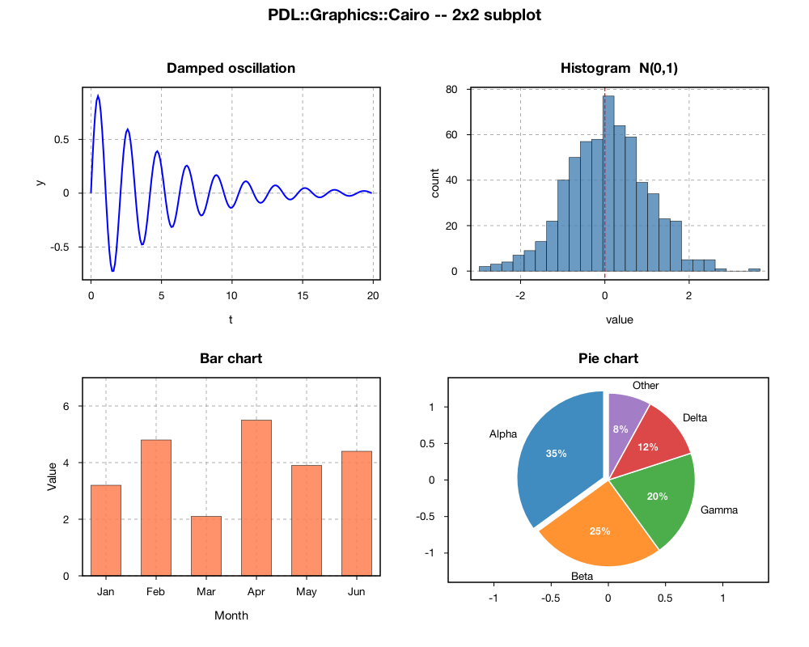
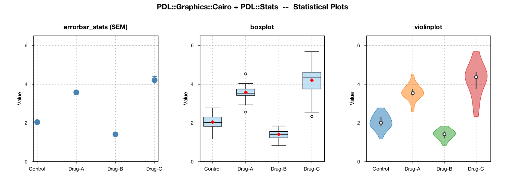

# PDL::Graphics::Cairo

PDL（Perl Data Language）向けの2Dプロットライブラリです。
CairoとPangoをレンダリングバックエンドとして使用します。

**macOS および Linux（Ubuntu/Debian）で動作します。**

matplotlib・PGPLOT・gnuplot、いずれのスタイルでも書けます。
PDL::Graphics::Cairo がレンダリングを担います。

## ギャラリー

各画像は、リンク先のスクリプト（`examples/`）で描いたものです。

<table>
<tr>
<td><a href="examples/specgram_demo.pl"></a><br><code>specgram_demo.pl</code> — 波形とスペクトログラム</td>
<td><a href="examples/example_contour.pl"></a><br><code>example_contour.pl</code> — contour / contourf</td>
</tr>
<tr>
<td><a href="examples/example_png.pl"></a><br><code>example_png.pl</code> — 2×2 の統計ダッシュボード</td>
<td><a href="examples/example_png.pl"></a><br><code>example_png.pl</code> — imshow とカラーマップ</td>
</tr>
<tr>
<td><a href="examples/example_colormap.pl"></a><br><code>example_colormap.pl</code> — ListedColormap（5 クラス）</td>
<td><a href="examples/example_colormap.pl"></a><br><code>example_colormap.pl</code> — BoundaryNorm + ListedColormap</td>
</tr>
<tr>
<td><a href="examples/example_show.pl"></a><br><code>example_show.pl</code></td>
<td><a href="examples/example_stats.pl"></a><br><code>example_stats.pl</code> — errorbar_stats / boxplot / violinplot</td>
</tr>
</table>

## 特徴

- matplotlib風API（`figure`、`axes`、`line`、`scatter`、`hist` など）
- PGPLOT互換レイヤー（`pgbegin`、`pgenv`、`pgline`、`pgbox`、`pgaxis`、`pgtick` など）
- gnuplot風のコマンド対応（matplotlib APIにマッピング）
- PNG・PDF・SVGファイル出力 — X11・libgiza 不要
- **giza_server による macOS ネイティブ表示** — macOS の既定。素の `$fig->show()` でネイティブウィンドウが開きます。Unix ドメインソケット経由のオンメモリ PNG 転送、プログラム終了後も残る永続タブウィンドウ、giza/PGPLOT の C プログラムと共有。Linux でも動作（GTK3/Xlib サーバ）
- **複数プロットをタブで1ウィンドウ表示**（giza_server）
- **グリッドスクラブ** `show_grid_scrub`（`Driver::GS`）— サブプロットをダブルクリックで拡大子窓を開き、トレース上をドラッグしてその潜時にマーカを置き、親の全サブプロットに同じ潜時の縦線を引く。選択点はマウスを離した後も保持し、開いている全子窓で共有。`main_scrub => 1` を指定すると、親窓のパネル上のクリック／ドラッグでも潜時を選べる。Axes に `$ax->{_scrub_skip} = 1` を立てたパネルには縦線を引かず、クリック対象にもしない（頭皮マップなど時間軸でないパネル用。ダブルクリックでの拡大は効く）。`static_key => sub { my ($state) = @_; ...; return $string }` を渡すと、親窓は `_scrub_skip` 以外のパネルを 1 回描いて背景として取っておき、その文字列か窓の大きさが変わったときだけ描き直す。毎コマは背景を写し、潜時の縦線と `_scrub_skip` のパネルだけを描く。**macOS（Cocoa）** giza_server 専用（2D のダブルクリック／ボタンドラッグを返すビルドが必要）。`PDLCAIRO_DEBUG=1` で1コマごとに `frame: build=.. png=.. send=.. gap=.. events=.. age=..`（描画コールバック・PNG化・ソケット書き込みの時間、同じ窓の前のコマからの間隔、その間に届いた入力の数、その最新のものの古さ）と `ack: ..ms after send` を出す
- gnuplot経由のインタラクティブ表示（aqua/wxt/x11）— クロスプラットフォーム。giza_server が無い場合の自動フォールバック
- レガシー macOS Cocoa ビューア（`backend => 'osx'`、`pdlcairo_viewer`）は **deprecated** なオプトインのフォールバックとしてのみ残置 — 既定ではなく、`make` でもビルドされません
- CairoによるAxes枠・目盛り・数値ラベルの描画
- Dual Y軸サポート（`twinx`）— 両軸独立した目盛り・ラベル。右のラベル（`set_right_ylabel`、または twin の `ylabel`）は右の目盛り数字の外側に描かれ、`tight_layout` が両方の幅を取る。matplotlib と同じく、`twinx` に `xlim`(`twiny` に `ylim`)を指定すると、共有している軸、つまり親の範囲になる
- 線幅はどの描画メソッドでも `lw` と `linewidth` のどちらでも指定でき、凡例の線も同じ太さになる
- 折れ線の間引き `$ax->line($x, $y, decimate => 'm4')`（M4、Jugel et al., PVLDB 2014）— 描くときに、描画領域の画素の列ごとに最初・最小・最大・最後の 4 点だけを残す。列はその描画の座標変換で決まるので、`tight_layout` や窓の大きさの変更の後もそろう。描画領域の外の点は、入る直前と出た直後の 1 点ずつだけ残し、マーカーは全点に描く。塗られる画素は間引かない線と同じ（1 列に多くの点が入る所では、アンチエイリアスの縁がわずかに薄い）。`PDL::Graphics::Cairo::LTTB` の `m4` / `m4_index_px` は、同じ選び方を描画領域の位置を指定して行う。`examples/eeg_viewer_raw.pl` の波形はこれで描く
- 黒背景サポート（`PGPLOT_BACKGROUND=black`）
- Negative-up Y軸: `pgenv`でymin>ymax、`$ax->ylim(lo, hi)`でlo>hiのとき自動反転
- `tight_layout()`によるマルチパネルサブプロット
- 6×6マルチパネル（36サブプロット）動作確認済み

---

## 使い方

慣れ親しんだスタイルでそのまま書けます。

### matplotlib 風に書く場合

```perl
use PDL;
use PDL::Graphics::Cairo qw(figure);

my $x   = sequence(200) / 10;
my $fig = figure(width => 800, height => 500);
my $ax  = $fig->axes();
$ax->line($x, sin($x), color => 'blue', label => 'sin(x)');
$ax->set_xlabel('x');
$ax->set_ylabel('y');
$ax->set_grid(1);
$ax->legend();
$fig->tight_layout();
$fig->save('plot.png');          # PNGファイル
$fig->show();                   # macOS: giza_server ウィンドウ（既定）／ Linux: gnuplot
$fig->show(terminal => 'aqua'); # AquaTerm経由（macOS）
```

### PGPLOT 風に書く場合

```perl
use PDL::Graphics::Cairo::PGPLOT qw(:all);

my @x = (-100 .. 899);
my @y = map { 10 + $_ * (-20 / 999) } (0 .. 999);
my $n = scalar @x;

pgbegin(0, "/osx", 1, 1);              # macOSネイティブ
# pgbegin(0, "/xw",  1, 1);            # X11（gnuplot経由）
# pgbegin(0, "/aqua", 1, 1);           # AquaTerm（gnuplot経由）
# pgbegin(0, "output.png/PNG", 1, 1);  # PNGファイル
# 第3・4引数 = NXSUB, NYSUB（分割数）。NXSUB<0 でパネルを列優先、>0 で行優先（PGPLOT準拠）

pgenv(-100, 899, 10, -10, 0, -2);      # negative up（ymin > ymax）
pgsci(3);                               # 緑
pgline($n, \@x, \@y);
pgsci(1);
pgbox("ANST", 0.0, 1, "ANTV", 5.0, 2);
pgmtxt("TR", -1, 0.1, 1.0, "Ch1");
pgend();
```

### gnuplot 風に書く場合

```perl
use PDL;
use PDL::Graphics::Cairo qw(figure);

my $x = pdl(-100 .. 899);
my $y = 10 + $x * (-20 / 999);

my $fig = figure(width => 800, height => 500);
my $ax  = $fig->axes();
$ax->line($x, $y, color => 'green', lw => 1.5);  # plot ... with lines lc "green"
$ax->set_xlim(-100, 899);                          # set xrange [-100:899]
$ax->set_ylim(10, -10);                            # set yrange [10:-10]（negative up）
$ax->text(870, 9.5, "Ch1", color => 'black');      # set label "Ch1" at ...
$fig->tight_layout();
$fig->show();                   # macOS: giza_server（既定）／ Linux: gnuplot
$fig->save('output.png');       # PNGファイル
```

各APIの詳細は[ドキュメント](#ドキュメント)セクションを参照してください。

### メソッド命名

setter は matplotlib の Axes-method 名を正準とします:
`set_xlim` / `set_ylim` / `set_xlabel` / `set_ylabel` / `set_title` /
`set_xticks` / `set_yticks`、および `plot`（`line` のエイリアス）。
短縮形の `xlim` / `ylim` / `xticks` / `yticks` は恒久エイリアスとして残し
（deprecated にはしません）、既存スクリプトと matplotlib の手癖の両方が
そのまま動きます。入口は `figure()` 関数で、`PDL::Graphics::Cairo->new()` は
同等のコンストラクタ風エイリアスです。

---

## インストール

```bash
perl Makefile.PL
make
make test
sudo make install
```

macOS のネイティブウィンドウ表示には `giza_server`（別バイナリ。下記
「インタラクティブ表示」参照）を使います。`make` が Cocoa ビューアを
ビルドすることはありません。

### 必要モジュール

- PDL >= 2.0
- Cairo（Perlバインディング）
- Pango（Perlバインディング）
- Moo

**macOS（MacPorts）:**
```bash
sudo port install p5-cairo p5-pango p5-moo
```

**Ubuntu/Debian:**
```bash
sudo apt install libcairo-perl libpango-perl libmoo-perl
sudo apt install gnuplot-x11   # インタラクティブ表示用
```

### インタラクティブ表示

#### giza_server — macOS の既定（Linux でも動作）

macOS では素の `$fig->show()` が `giza_server` 経由でネイティブウィンドウを
開きます。通常 backend を指定する必要はありません：

```perl
$fig->show();                                     # macOS 既定: giza_server
$fig->show(backend => 'gs');                      # 明示。サーバを自動起動
$fig->show(backend => 'gs', start => 'connect');  # 起動中のサーバへ接続のみ
```

図をオンメモリ PNG にレンダリングし、Unix ドメインソケット経由で
`giza_server` プロセスへ送ります（テンポラリファイル不要）。ウィンドウは
サーバが所有するためプログラム終了後も残り、タブ表示され、`/gs` デバイスを
使う giza/PGPLOT の C/Fortran プログラムと共有されます。バイナリは
`$GIZA_SERVER`、兄弟 `../giza-server` チェックアウト、または `$PATH` から
検出されます。https://github.com/goosh-gh/giza-server を参照。

`giza_server` が無い場合、`show()` は gnuplot へフォールバックします
（レガシー Cocoa ビューアへは行きません）。`wait_all()` は `gs` 経路では
no-op です（ウィンドウは既に永続）。従来の `nowait` + `wait_all` スクリプトは
そのまま動きます。

**インタラクティブモード（`show_interactive`）。** 一回限りの `show()` の
代わりに、`gs` ドライバはソケットを保持してコールバックから随時再描画でき
ます。コールバックは現在の状態と窓サイズを受け取り、新しい figure を返し
ます：

```perl
my $gs = PDL::Graphics::Cairo::Driver::GS->new(width=>640, height=>480);
$gs->show_interactive(
    render => sub {
        my ($state, $w, $h) = @_;          # $w/$h = 現在のキャンバスサイズ(px)
        my $fig = figure(width=>$w, height=>$h);
        ...                                # $state から figure を構築
        return $fig;
    },
);
```

サーバは GSP の逆チャネルでこのコールバックを駆動します。ビューアのスライダ
は `$state` を更新し、**窓のリサイズは新サイズで replot されます** —
`$w`/`$h` を `figure(...)` に渡すと、ビットマップ拡大ではなく（くっきりと）
再レイアウトされます。リサイズ replot は現状 macOS（Cocoa）のみ。`$w`/`$h`
を無視するコールバックは figure サイズが固定のままになり、リサイズしても窓
を埋めません。`examples/example_gs.pl`、`examples/example_gs_slider.pl` を
参照。

`cursor_overlay => 1` でマウスの位置を描くときは、
`redraw_key => sub { my ($state) = @_; ...; return $string }` を渡すと、マウスの
移動やクリックで、その文字列（と窓の大きさ）が変わったときだけ描き直します
（マウスがボタンの帯の上にあるときなどは描き直さない）。

#### gnuplot経由（クロスプラットフォームのフォールバック）

```bash
# macOS
sudo port install gnuplot +aquaterm   # または +x11

# Ubuntu/Debian
sudo apt install gnuplot-x11
```

#### レガシー Cocoa ビューア（deprecated）

`backend => 'osx'`（スタンドアロンの `pdlcairo_viewer` Cocoa アプリ）は退役し、
deprecated なオプトインのフォールバックとしてのみ残しています。既定ではなく、
`make` でもビルドされません。新規コードは既定の `giza_server` 経路を使ってください。

---

## ディレクトリ構成

```
PDL-Graphics-Cairo/
├── lib/PDL/Graphics/Cairo/
│   ├── Cairo.pm          # 公開APIエントリポイント: figure(), subplots()
│   ├── Figure.pm         # Figureクラス: save(), show(), tight_layout()
│   ├── Axes.pm           # Axesクラス: line(), scatter(), xlim(), ylim(), ...（API・範囲・レイアウト・描画の流れ）
│   ├── Axes/
│   │   ├── Render/*.pm   # 種類ごとの描画（Basic, Bar, Image, Stats, Text）。Axes と同じパッケージ
│   │   └── Decor.pm      # グリッド・枠・目盛り・ラベル・凡例・colorbar・twin の軸。Axes と同じパッケージ
│   ├── PGPLOT.pm         # PGPLOT互換レイヤー: pgbegin/pgline/pgend/...
│   ├── Driver/
│   │   ├── Cairo.pm      # Cairo/Pangoレンダリングバックエンド（PNG/PDF/SVG出力）
│   │   ├── GS.pm         # giza_serverバックエンド（macOSネイティブ表示の既定。Linuxも）
│   │   ├── OSX.pm        # レガシーCocoaバックエンド（deprecated; pdlcairo_viewer経由）
│   │   └── Gnuplot.pm    # gnuplot表示バックエンド（aqua/wxt/x11）
│   ├── Transform/        # 座標変換（linear, log）
│   ├── ColorMap.pm       # カラーマップ（viridis, plasma, ...）
│   └── Tick.pm           # 目盛り計算
├── src/osx/              # レガシーCocoaビューア（deprecated; make でビルドしない）
│   ├── pdlcairo_viewer.m # スタンドアロンCocoaビューアアプリ（macOSのみ）
│   └── build.sh          # pdlcairo_viewer のビルドスクリプト
├── docs/
│   ├── PGPLOT_compatibility_en.md
│   ├── PGPLOT_compatibility_ja.md
│   ├── gnuplot_compatibility.md
│   └── matplotlib_comparison.md
└── examples/
```

### 2つのCairo.pmの役割分担

`Cairo.pm`という名前のファイルが2つありますが、役割は全く異なります：

| ファイル | 役割 |
|----------|------|
| `lib/PDL/Graphics/Cairo.pm` | 公開APIエントリポイント。`figure()`と`subplots()`をエクスポートする。ユーザーが`use PDL::Graphics::Cairo`で読み込むファイル。 |
| `lib/PDL/Graphics/Cairo/Driver/Cairo.pm` | 内部レンダリングドライバ。Cairo/Pango Cライブラリを使って線・テキスト・図形をイメージサーフェスに描画し、PNG/PDF/SVGとして保存する。ユーザーが直接読み込むことはない。 |

---

## tight_layout()

`$fig->save()` や `$fig->show()` で描画するとき、`tight_layout()` がまだ
呼ばれていなければ自動で呼ばれます。明示的に呼ぶのは、`pad` などの
オプションを指定したいときです。呼んだ時点の内容でレイアウトが決まり、
描画のときには計算し直されないので、Axes・ラベル・タイトルをすべて
作ってから呼んでください：

```perl
$ax->set_xlabel('x');
$ax->set_ylabel('y');
$fig->tight_layout(pad => 1.2);   # 内容をすべて作った後で
$fig->save('plot.png');
```

`tight_layout()` は、呼んだ時点のデータと `xlim`/`ylim` から目盛り数字を
求め、目盛り数字・xlabel・ylabel・タイトルの大きさを Cairo で測って、
それが入る余白を取ります。`-2.00e+04` のような長い目盛り数字でも ylabel が
図の外に出ず、高さの低い図でも xlabel が切れません。ただし、ごく小さい
セルでは、描画領域を残すために余白をセルの 80% までに抑えます。

## 凡例を軸枠の外に置く

```perl
$ax->legend(loc => 'outside top');    # タイトルの行に横 1 列、軸枠の右端にそろえる
$ax->legend(loc => 'outside right');  # 軸枠の右に縦 1 列、軸枠はその分狭くなる
$ax->legend(loc => 'outside');        # 項目が outside_max(既定 3)以下なら top、多ければ right
```

`outside top` では、タイトルと重なるときはタイトルを左寄せにし、それでも
入らなければ凡例をタイトルの下(軸枠のすぐ上)の行に置きます。枠の外の
凡例には箱を描きません。余白は `tight_layout()` が取ります。
`upper right`(既定)・`upper left`・`lower right`・`lower left` は、
これまでどおり軸枠の内側に箱付きで描きます。

---

## macOSネイティブバックエンド

macOS のネイティブ表示は `giza_server`（既定）が担当します。図をオンメモリ
PNG にレンダリングし、Unix ドメインソケット経由でサーバへストリームします。
サーバがタブ表示の永続ネイティブウィンドウを所有します：

```
Cairo image surface（ソフトウェアレンダリング）
    ↓ Unix ドメインソケット経由のオンメモリ PNG（テンポラリファイル不要）
giza_server（別プロセス — macOS は Cocoa、Linux は GTK3/Xlib）
    ↓ NSImage / GTK → ネイティブウィンドウ（タブ・永続）
ネイティブウィンドウ
```

レガシーのスタンドアロン `pdlcairo_viewer` Cocoa アプリ（`backend => 'osx'`）は
deprecated で、`make` でもビルドされません。

---

## 環境変数

| 変数 | 説明 |
|------|------|
| `PGPLOT_BACKGROUND` | `black` で黒背景（デフォルト: white） |
| `PGPLOT_DEV` | `pgbegin`のデフォルトデバイス。指定可能な値: `/OSX` `/XW` `/XWIN` `/X11` `/XSERVE` `/AQT` `/AQUA` `/WXT` `/QT` `/PNG` `/PDF` `/SVG` `/PS` `/CPS` |
| `PDLCAIRO_BACKEND` | `show()` のバックエンドを上書き: `gs`（macOS の既定）、`gnuplot`、`osx`（deprecated） |
| `GIZA_SERVER` | `giza_server` バイナリのフルパスを指定（自動検出を上書き） |
| `PDLCAIRO_VIEWER` | レガシー `pdlcairo_viewer` バイナリのフルパス（deprecated な `osx` バックエンド用） |
| `PDLCAIRO_DEBUG` | `1` で `gs` ドライバが描画・PNG化の時間を出す（`show_grid_scrub` では1コマごとの `frame:` / `ack:` も） |
| `PDLCAIRO_PNG_LEVEL` | giza_server へ送る PNG の zlib 圧縮レベル（既定 1）。PNG はメモリ上で作る（`PDL::IO::PNG::png_encode` があればそれ、無ければ `Compress::Zlib`。透明な画素のある図はファイル経由の経路） |

---

## プロット種別（matplotlib API）

| メソッド | 説明 |
|----------|------|
| `line` | 折れ線グラフ（`decimate => 'm4'` で画素の列ごとに 4 点に間引く） |
| `scatter` | 散布図（カラーマップ対応） |
| `bar` / `barh` | 縦・横棒グラフ |
| `hist` / `hist_kde` | ヒストグラム / KDEオーバーレイ |
| `errorbar` / `errorbar_stats` | エラーバー。`errorbar(..., lw => 0)` は点を線で結ばない（凡例はマーカー）。`errorbar_stats` は `lw` を指定しない限り結ばない |
| `fill_between` | 塗りつぶし帯 |
| `step` | ステップ関数 |
| `stem` | ステムプロット（`label` は凡例に丸いマーカーで出る） |
| `imshow` | 2D画像（カラーバー付き）。画像全体を1回で描く（セルは平滑化せずに拡大）。値が有限でないセルは透明 |
| `contourf` | 等高線（塗りつぶし） |
| `pie` | 円グラフ |
| `boxplot` | 箱ひげ図 |
| `violinplot` | バイオリンプロット |
| `qqplot` | Q-Qプロット（正規分布比較） |
| `heatmap` | ヒートマップ（ラベル付き）。値ごとに 1 セル、行 0 が上。値が有限でないセルは塗らない。`annot => 1` で各セルに値（`fmt`、既定 `%.1f`）を書く |
| `stackplot` | 積み上げ面グラフ |
| `eventplot` | ラスタ・スパイクプロット |
| `axhline` / `axvline` | 水平・垂直参照線 |
| `axvspan` / `axhspan` | 網掛け領域 |
| `annotate` | 矢印アノテーション |
| `$fig->add_connection` | 異なる Axes の2点を結ぶ直線（matplotlib `ConnectionPatch` 相当）。各端点は `'data'` / `'axes'`（プロット枠内の割合）/ `'figure'`（Figure 内の割合）座標、または `['data','axes']` のように成分ごとに指定。全 Axes の上にクリップなしで描く |
| `$fig->add_text` | `add_connection` と同じ座標指定で置くテキスト。全 Axes の上にクリップなしで描くので、プロット枠のすぐ外にも置ける。`ha` / `va` / `offset`(px) / `fontsize` / `weight` / `color` / `angle` |
| GridSpec / `subplot_mosaic` の `$fig->tight_layout` | `cell_margins` を指定しない GridSpec で `$fig->tight_layout` を呼ぶと、各パネルが描画領域の周りに要る幅（目盛りの数字・ラベル・タイトル・colorbar・twin の軸）から配置を決める（matplotlib の `tight_layout` と同じ）。GridSpec の `left` / `right` / `top` / `bottom` / `hspace` / `wspace` は置き換えられ、同じ行（列）のパネルの描画領域がそろい、残りの高さ（幅）を `height_ratios` / `width_ratios` で分ける。`save` / `show` が自分でレイアウトするときと、`set_position` で置いたパネルは、GridSpec 自身の位置と隙間のまま |
| `add_gridspec(..., cell_margins => 0)` | その GridSpec に置く全 Axes に同じ固定余白を与える。グリッド内の位置や空きマスに関係なく、全パネルの描画領域が同じ大きさになる。`0` ではマスそのものがプロット枠になり（matplotlib と同じ）、目盛りの数字やラベルはマス間の隙間（`wspace` / `hspace`）とグリッドの外側（`left` / `right` / `top` / `bottom`）に描かれる。数値は四辺とも同じ px、ハッシュは辺ごと: `cell_margins => { left => 30, bottom => 20 }` |
| `$fig->label_only($ax)` | 目盛りの数字を `$ax`（または `[$ax, ...]`）だけに出す。`axis => 'x' \| 'y' \| 'both'`、`axes => [...]`。目盛り線は全パネルに残る |
| `$fig->label_outer` | y の数字を各行の左端のパネルだけ、x の数字を各列の最下段のパネルだけに出す。行と列はパネルの位置から求めるので、空きマスのあるグリッドでも使える |
| `$ax->colorbar(cmap => ..., vmin => ..., vmax => ...)` | その Axes の描画コマンドに由来しないカラーバーを付ける（呼び出し側が自分で色付けした画像用）。`cmap` はカラーマップ名、または `rgb_at($v)` を持つオブジェクト。`axis('off')` のパネルにも描く。`reserve => 0` でプロット枠からカラーバー分の幅を取らない（縦横比固定の画像がパネル中央に残り、バーはその横に描かれる）。`tick_step => 1` で目盛りを自動選択ではなくその値の倍数に置く（短いバーで数字が重なるときは 2 つおき、3 つおき…に間引く） |
| `data_to_pixel` / `axes_to_pixel` | データ座標・プロット枠内割合 → Figure ピクセル座標（描画後に有効） |
| `clip_pad_top` | プロット枠の上側にデータ描画がはみ出せる量（既定 15 px、0 で上端ちょうどでクリップ） |
| `twinx` | 双Y軸（両軸独立した目盛り） |

---

## ドキュメント

| ファイル | 内容 |
|----------|------|
| `docs/PGPLOT_compatibility_en.md` | PGPLOT互換レイヤー — 関数一覧・デバイス文字列（英語） |
| `docs/PGPLOT_compatibility_ja.md` | 同上（日本語） |
| `docs/gnuplot_compatibility.md` | gnuplotコマンドとのマッピング・比較（英語） |
| `docs/matplotlib_comparison.md` | matplotlib vs PDL::Graphics::Cairo 比較 |

---

## 実行例

```bash
# クロスプラットフォーム（macOS・Linux共通）
perl examples/example_png.pl               # 基本PNG出力
perl examples/example_stats.pl             # 統計プロット
perl examples/example_cairo_api.pl         # matplotlib風（negative-up Y軸）
perl examples/example_pgplot.pl            # PGPLOT互換API

# インタラクティブ表示
perl examples/example_show.pl              # 自動検出
perl examples/example_show.pl osx          # macOSネイティブ（macOSのみ）
perl examples/example_show.pl aqua         # gnuplot/AquaTerm（macOS）
perl examples/example_show.pl x11          # gnuplot/X11（Linux/XQuartz）

# macOS 4パネルデモ
perl examples/pdlcairo_osx_demo.pl         # macOSネイティブ
perl examples/pdlcairo_osx_demo.pl gnuplot # gnuplot経由
```

---

## ライセンス

このライブラリはフリーソフトウェアです。Perl自体と同じ条件のもとで
再配布・改変することができます。
